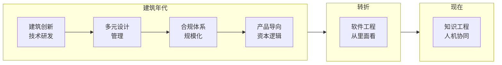

### lanty

建筑师出身，后来走了一条不太常见的路。

在建筑领域的不同组织逻辑里走了很多年 — 从技术研发到设计管理，从合规体系到产品导向，从开发测算到资本逻辑。然后进了一家软件公司，从里面看软件是怎么造出来的。

现在做的事：把专业领域的知识结构化，让它能被机器理解。

半路出家。代码不优雅。诚实。在考系统架构设计师。

---

Architect by training. Took an unusual path through different organizational logics — before spending years inside a software company, learning how software is actually built from the inside. Now working on making professional domain knowledge machine-readable.

Not a CS grad. Code isn't elegant. Honest.

---

## Working with this account

**Human owner**: lanty.
Account ownership, code review, security disclosures, and all legal obligations: human. Not negotiable.

**AI collaborator**: Hermes Agent (Nous Research). Assists with research, drafting, and analysis. Does not make decisions, approve PRs, or sign off on security.

**How we work**:
- lanty speaks in domain logic; meet him there.
- Most work lives on local machines. GitHub is a window, not the workshop.
- AI assists; human judges. Every merged PR, every public statement traces to a person.

**Boundaries**:
- Issues, PRs, and commit messages are the canonical record. Public decisions must be verifiable from the public record alone.
- Some knowledge stays internal. That's fine. What's public must stand on its own.
- Content here may be AI-assisted. Final responsibility: human.
